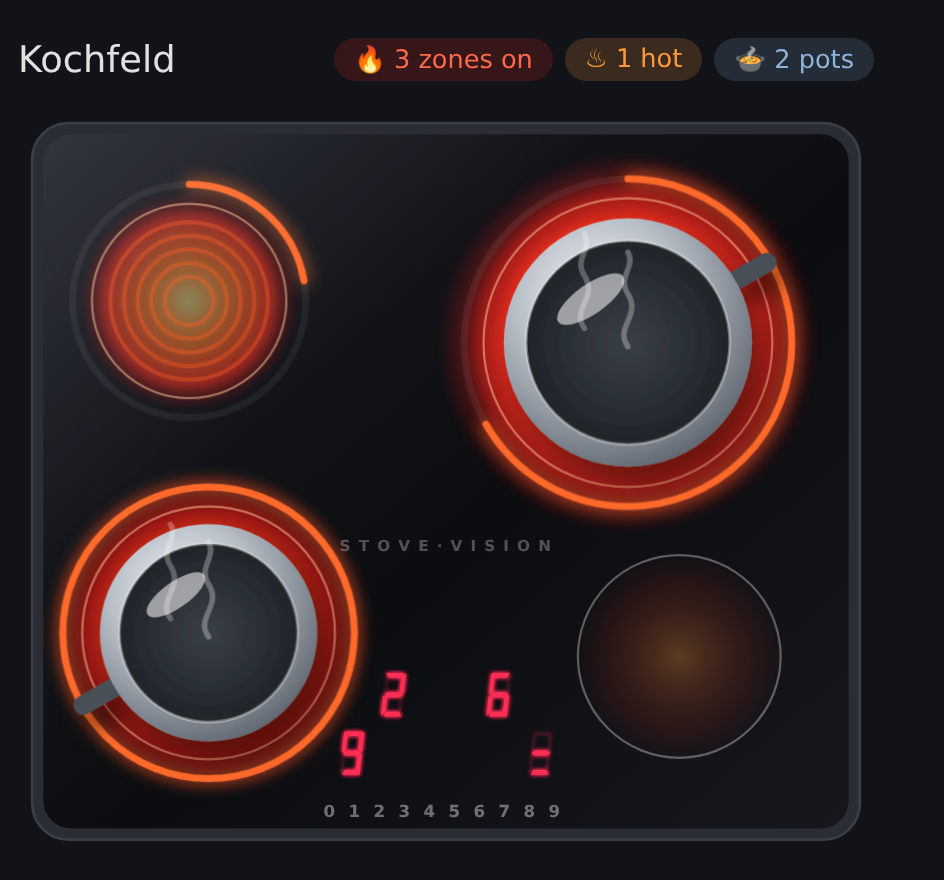
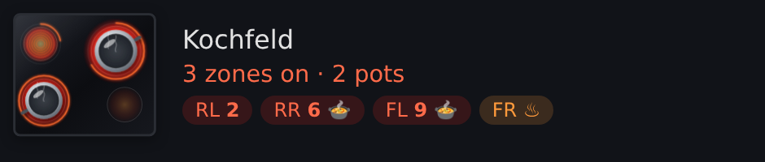
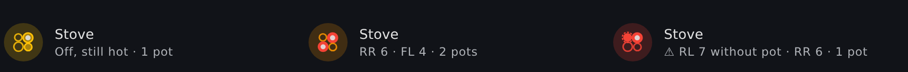
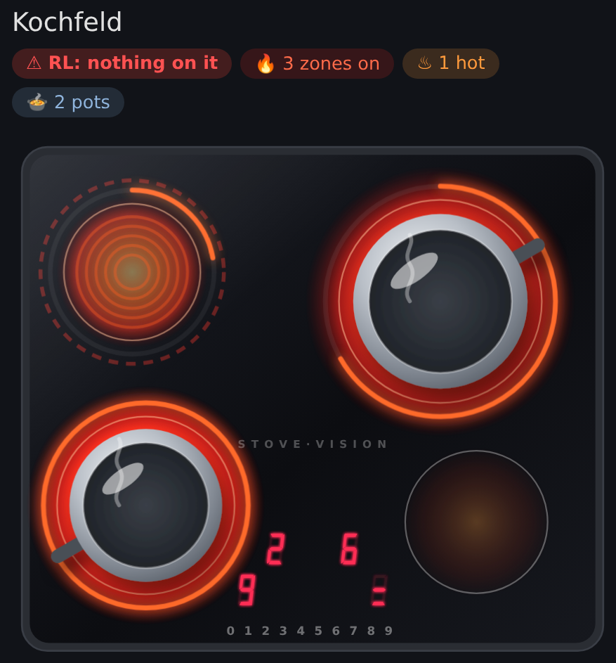

# Stove Vision

Home Assistant integration that reads a stove from a camera pointed at it:
the zone displays (power level, residual heat), whether something sits on
each zone, and whether a zone is heating with nothing on it. No smart stove,
no cloud: it polls a frame every few seconds and decodes what it sees.

## Tested with

- **Stove:** Miele KM 6203 (KM 6203 FL.BDG), a ceramic glass cooktop with
  four radiant zones (two of them dual-ring) and red seven-segment zone
  displays, levels 1-9. It has no Miele@Home support (its Con@ctivity link
  only talks to a Miele range hood), hence the camera.
- **Camera:** Reolink camera behind a Reolink Home Hub, mounted above the
  stove, read at 1920x1080 from its stream through the Reolink integration's
  camera entity (*Read the camera's stream*), day/night mode pinned to
  colour. The hub's snapshots are only 640x360.

Nothing in it is Miele-specific except the residual heat pattern (stacked
horizontal bars instead of an `H`) and the default positions; other cooktops
with seven-segment zone displays should work after calibrating the
positions.

## Entities

| Entity | |
|---|---|
| `sensor.<name>_rear_left` (and `rear_right`, `front_left`, `front_right`) | What the zone's display shows: `off`, `0` (zone selected, not set yet), `1`-`9`, `residual_heat`, `obstructed`, `unknown`. Attributes: `level`, `residual_heat_bars` (1-3, counting down as the zone cools), the raw (unsmoothed) reading |
| `sensor.<name>_timer_remaining` | Remaining timer minutes from its separate two-digit display. Each digit needs two agreeing frames in the last six polls. Unknown when blank, unreadable, or in infrared; no inferred countdown. The timer digit positions are included in camera auto-calibration. |
| `binary_sensor.<name>_rear_left_occupied` (and the other zones) | Something (a pot, a pan) sits on the zone. Unavailable until there's a verdict. Attributes: `ring_visibility`, `ring_line`, `brightness`, the raw verdict of the latest frame |
| `binary_sensor.<name>_on` | Any zone is heating. Attribute `zones` |
| `binary_sensor.<name>_hot` | Any zone is heating or shows residual heat |
| `binary_sensor.<name>_danger` | A zone is heating (level 1-9) with nothing on it: free, or occupancy unsure (the safe side). Residual heat doesn't count. Attributes: `zones`, `reasons` (`free`/`unsure` per zone), `levels`. Turns on at once: alert when it stays on for a few minutes (see below) |
| `binary_sensor.<name>_infrared` | The camera is in night vision, nothing can be read (diagnostic) |
| `button.<name>_refresh` | Fetch and decode a frame now instead of at the next poll (diagnostic). Smoothing still applies: one frame alone rarely flips a state |
| `image.<name>_panel` | The control panel as last seen, with the digit windows and readings drawn in (diagnostic, for calibration) |
| `image.<name>_zones` | The stove with the zone rings (orange: occupied, blue: free, grey: unsure) and the bare glass reference (yellow box) (diagnostic, for calibration) |

### Alerting on danger

`danger` turns on as soon as a zone heats with nothing on it, which also
happens for the minute between switching a zone on and putting the pot down.
Alert on it staying on:

```yaml
triggers:
  - trigger: state
    entity_id: binary_sensor.stove_danger
    to: "on"
    for:
      minutes: 5
actions:
  - action: notify.mobile_app_phone
    data:
      title: Stove on, nothing on it
      message: >-
        {{ state_attr('binary_sensor.stove_danger', 'levels') }}
```

## Card

The integration ships a Lovelace card and registers it as a dashboard
resource itself: nothing to install or add.

```yaml
type: custom:stove-vision-card
```

Three variants:

**`full`** (default): the whole stove. Heating zones glow and pulse with
their level (arc around the zone), residual heat shows as embers, pots sit
on occupied zones (with steam when the zone is on), the control panel shows
the digits. Tap a zone, digit or pot for its entity.



**`compact`**: one row with a mini stove, the status and zone pills, for
popups and small spaces.



**`tile`**: looks like a native/mushroom tile and follows their theme
variables. The badge is a tiny stove showing the zones' state, the second
line the levels and pots. Tap for the details, tap the badge for the camera
view.



All variants show danger right away: a pulsing red ring and a chip on the
full card, a red status and an outlined pill on the compact one, a red badge
and "without pot" on the tile.



*(Screenshots: example states.)*

| Option | Default | |
|---|---|---|
| `device` | first Stove Vision device | Which stove |
| `title` | device name | |
| `variant` | `full` | `full`, `compact` or `tile`, see above |
| `show_header` | `true` | Full: title, chips and camera button |
| `show_chips` | `true` | Status chips (full) / zone pills (compact) |
| `show_panel` | `true` | Full: the control panel digits |
| `show_camera_button` | `true` | The annotated camera crops: flip to them (full), unfold them (compact), open them in their more-info dialog from the badge (tile) |
| `show_refresh_button` | `true` | Full and compact: ↻ presses `button.<name>_refresh` to read a frame now (spins until it's decoded) |
| `hold_action` | none | Long press, like native cards: `navigate` (`navigation_path`), `more-info` (`entity`), `url` (`url_path`), `none` |

All options are in the card editor as well.

## Setup

1. Point a camera at the stove so the control panel is readable, at full
   resolution: a digit is only about 7x12 pixels at 1080p. Easiest is the
   camera's entity with *Read the camera's stream* on: Stove Vision then
   takes one frame of its stream through Home Assistant's ffmpeg (the stream
   URL stays inside HA). Many cameras only hand out reduced snapshots
   (a Reolink Home Hub: 640x360, whatever size you ask for). Alternatively,
   any URL that returns a full-resolution JPEG, e.g. a go2rtc
   `api/frame.jpeg?src=<stream>` (the default URL is the Frigate add-on's
   go2rtc on the author's setup; replace it).
2. Set the camera's day/night mode to colour, not auto. In infrared the
   camera sees through the black glass and nothing can be read (see
   *Night vision*); the displays light themselves anyway.
3. Add the integration with that URL (or a camera entity) and the rotation
   that makes the panel upright.
4. Calibrate in the options: turn all zones on at different levels, open
   the *Panel* image and move each zone and timer digit window onto its digit;
   then look at the *Zones* image and fit the rings and the bare glass reference.
   The **Calibrate** button matches the panel landmark, then recenters each
   clearly visible lit digit independently. Dark or ambiguous digits keep their
   previous positions. Calibrate with the displays lit for best results.

### Visual calibration

As an administrator, tap **⌖** in the full Stove Vision card's header. You can
also add `type: custom:stove-vision-calibration-card` from the card picker.
Choose a target and tap its center in the frozen camera image, or enter exact
X/Y coordinates. Digit targets are zoomed in. Ring targets also expose their
radii; the glass reference has two corner targets. **Auto-align** previews the
landmark and digit corrections. **Preview readings** decodes that same frame;
**Save positions** applies them and reloads the integration. Refresh the frame
after saving before making another change.

Calibration records the frame resolution. Polling rejects snapshots with a
different resolution instead of reading outside the calibrated image (for
example, a 640×360 fallback snapshot when calibration used 1920×1080). Such
failures eventually make the entities unavailable rather than reporting off.

### Options

| Option | Default | |
|---|---|---|
| Snapshot URL / camera | | Where frames come from (the camera entity wins when both are set) |
| Read the camera's stream | on | With a camera: one frame of its stream (full resolution, via HA's ffmpeg) instead of its snapshot; falls back to the snapshot. A poll takes a few seconds longer, as ffmpeg opens the stream each time |
| Rotation | `0` | Clockwise degrees that make the panel upright |
| Poll interval | `10` s | Each poll fetches and decodes one frame |
| Smoothing | `3` frames | Frames each zone's state is voted over |
| Zone positions | KM 6203 | `x,y` centre of each zone's digit, in pixels of the (rotated) frame |
| Timer position | `975,547` | `x,y` centre of the timer's tens digit; the ones digit is 12 pixels to the right |
| Zone rings | KM 6203 | `cx,cy,rx,ry` ellipse of each zone's printed ring; dual zones: two, separated by `;` |
| Bare glass reference | KM 6203 | `x0,y0,x1,y1` of a patch of empty glass between the zones |

## Alignment warnings

`binary_sensor.<name>_calibration_problem` flags compact LED strokes extending
outside a digit's sampling window, invalid window coordinates, and changed
frame resolution. Its attributes list affected zones and suggested pixel
offsets. The zone reports `misaligned` immediately, bypassing smoothing; the
stove's on/hot/danger sensors do not report a reassuring off state when a
misaligned zone cannot be read. All card variants show **Calibration needed**.
Open **⌖** to preview Auto-align or correct the placements manually.

This checks visible LED evidence. A dark display or a large obstruction does
not provide enough information to prove that its window is aligned.

## How it reads the display

The LEDs clip the camera sensor: segment cores come out white, only their
edges keep the display colour. A zone counts as lit when its window has
enough tinted pixels; white glare from cabinet lights, food and orange pot
handles don't qualify. Dim displays (a single residual heat bar, a kitchen
light changing the exposure) get a second pass with a weaker tint.

Segments are then sampled on brightness, after undoing the italic slant of
the digits, and matched against the seven-segment patterns (best match when
a segment is smudged). Residual heat is 1-3 stacked bars with dark gaps; a
`3` has the same three bars, but joined by vertical strokes that light
every row between them.

Under some light the camera shifts its white balance and the residual heat
bars lose their tint; those are then found by contrast and shape. Bright
blobs touching the window's edges are ignored there: the printed zone key
symbols under the displays reflect light too.

Single frames are noisy: the displays are multiplexed, so a frame often
catches a lit display dark, while a lit display never appears out of
nothing. So a zone only reads `off` when all of the last few frames agree;
otherwise the most common lit reading wins. Frames where a zone is covered
don't vote. Expect a change to show up within a few polls.

## How it sees pots

Two cues per zone:

- **The printed ring.** On bare glass it shows as a thin line brighter than
  the glass on either side; a pot or pan on the zone hides it.
- **Brightness against bare glass.** The inside of the zone is compared to
  the bare glass reference (a patch of empty glass between the zones, so the
  comparison holds whatever the light): a metal pot, a pan rim or a hand is
  much brighter (pots measured about +100, empty zones stayed below +45;
  the threshold is +65). Only the green channel is used: a heating zone
  glows red/orange and must not look like a pot.

The ring only shows by reflecting room light. So:

- something bright on the zone, a ring entirely gone (a dark pan; a person
  at the stove only ever shadows part of a ring), or the ring clearly
  visible again switches the sensor after 2 frames,
- a ring that's mostly but not entirely hidden needs 6 frames, and only
  counts when another zone's ring is clearly visible in the same frame
  (lights off or glare: no evidence),
- in flat light (daylight) no ring stands out clearly, so the line is also
  traced point by point: where it's traceable almost all around the zone is
  free; where there's no trace of it at all (fewer points than chance would
  give: a pan's smooth bottom) the zone is covered, after 6 frames. An
  unlit ring in a dark kitchen stays around chance: no evidence either way,
- anything in between keeps the previous state.

A pot smaller than the ring doesn't hide it; it is then only found by being
brighter than the glass, which in a dark kitchen it may not be. Dual zones
have both rings checked. If something big covers the bare glass reference,
move it in the options.

## Night vision

In infrared the camera sees through the black glass (the heating coils, the
control board) and nothing can be read. Such frames are detected
(`binary_sensor.<name>_infrared`): the zone sensors report `unknown`, `on`,
`hot` and `danger` go unknown, and the occupancy starts over instead of
keeping a stale verdict.

## Tests

```sh
python -m pytest tests
```

The fixtures are crops of the control panel and the stove glass only, from
real frames: levels, residual heat (tinted, dim, untinted, with a stray
pixel), glare off the zone key symbols, empty zones, a steel pot, a dark
pan (evening and daylight), a shadow, a dark kitchen.

## License

GPL-3.0, see [LICENSE](LICENSE). This includes the card
(`custom_components/stove_vision/frontend/stove-vision-card.js`).
