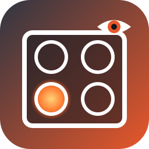

<p align="center">
  
</p>

<p align="center">
  <a href="https://my.home-assistant.io/redirect/marketplace_repository/?owner=pschmitt&amp;repository=homeassistant-stove-vision&amp;category=integration"></a>
</p>

<h1 align="center">Stove Vision</h1>

<p align="center">Read cooktop displays and zone occupancy from a camera in Home Assistant.</p>

Developed for a Miele KM 6203 with a full-resolution camera stream. Other
seven-segment cooktops need calibration and are not tested. Camera detection
is not a substitute for attending a hot stove or a safety device.

## Features

- **Zone readings:** Detect power levels, residual heat and timer digits from camera frames. See [Detection and entities](docs/detection.md).
- **Occupancy and advisories:** Report covered zones and possible heating without a pot, including uncertain readings.
- **Visual calibration:** Adjust digit windows and zone rings from an annotated camera image. See [Camera and calibration](docs/calibration.md).
- **Dashboard cards:** Show full, compact or tile views and access a calibration card. See [Dashboard cards](docs/cards.md).

## Install

Use the Marketplace badge above on Home Assistant 2026.11 or later to add this
repository as a custom integration. On older versions, add it as a HACS
custom repository of type **Integration**. Install and restart Home Assistant.
The badge does not imply a public catalog listing. For manual installation,
copy `custom_components/stove_vision/` into Home Assistant's
`custom_components/` directory and restart.

## Quick start

1. Point a full-resolution camera at the cooktop and keep its night vision off.
2. Add **Stove Vision** under **Settings → Devices & services → Add integration** and select the camera or snapshot URL.
3. Open the annotated **Panel** and **Zones** images, then calibrate digit windows and ring positions. See [Camera and calibration](docs/calibration.md).
4. Add the card to a dashboard:

```yaml
type: custom:stove-vision-card
```

## Documentation

| Topic | Description |
|-------|-------------|
| [Camera and calibration](docs/calibration.md) | Camera requirements, positions and alignment |
| [Detection and entities](docs/detection.md) | Zone readings, occupancy, timer and limits |
| [Dashboard cards](docs/cards.md) | Variants, screenshots and card options |

## License

[GPL-3.0](LICENSE), including the dashboard card.
