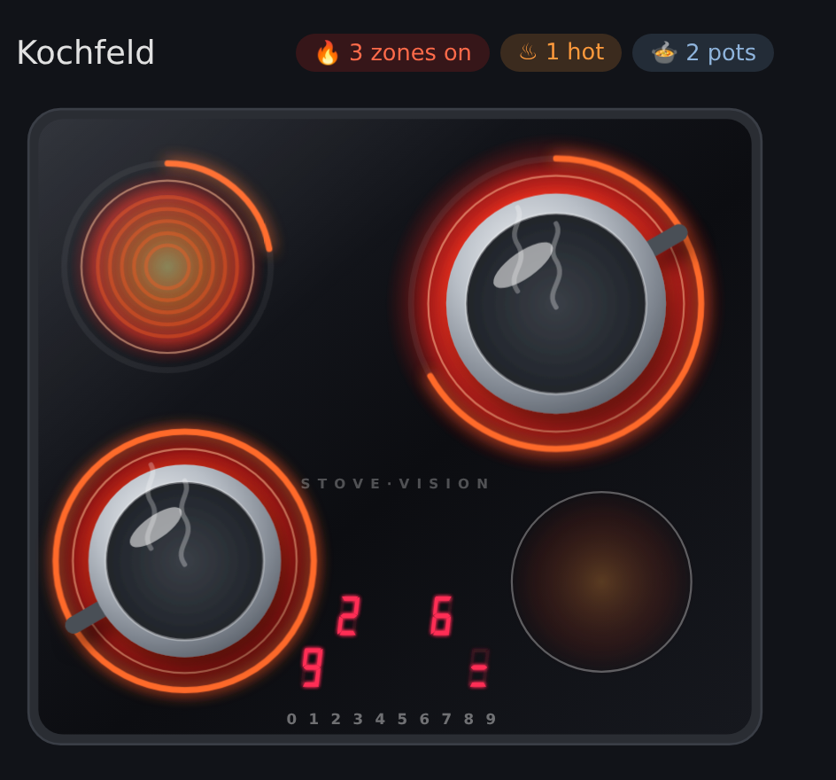
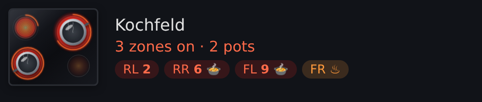
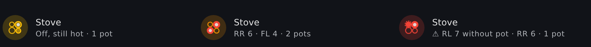
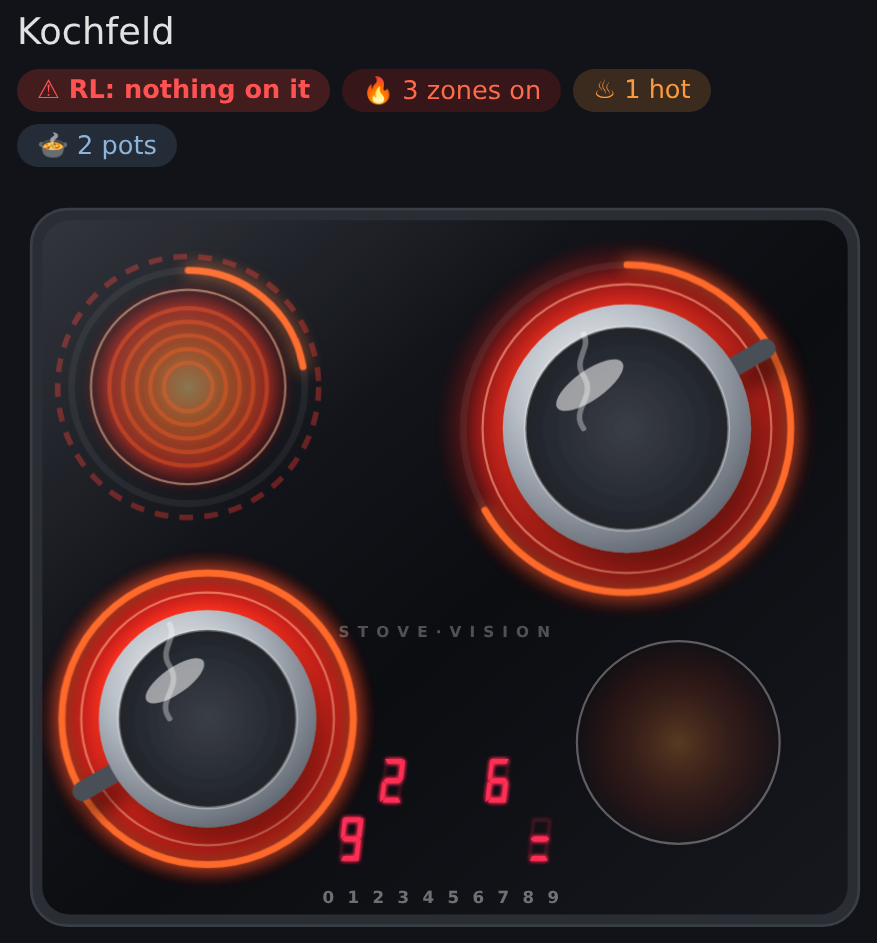

# Dashboard cards

The integration registers `custom:stove-vision-card` as a dashboard resource.
Its full view shows zones, control-panel digits, residual heat, occupancy and
advisory state; tapping an element opens its entity. The compact variant fits
small spaces, and the tile variant uses native-style colors and a stove badge.
All variants show a danger state when the integration detects one.

| Variant | Preview |
|---------|---------|
| Full |  |
| Compact |  |
| Tile |  |
| Danger |  |

Choose a variant in the card editor or configure it in YAML:

```yaml
type: custom:stove-vision-card
variant: compact
```

Options include `device`, `title`, `variant` (`full`, `compact`, `tile`),
`show_header`, `show_chips`, `show_panel`, `show_camera_button`,
`show_refresh_button` and `hold_action`. The camera control opens annotated
crops; refresh requests a new frame. The administrator-only
`custom:stove-vision-calibration-card` provides a frozen frame for adjusting
digits, rings and the reference patch; see [Camera and calibration](calibration.md).
